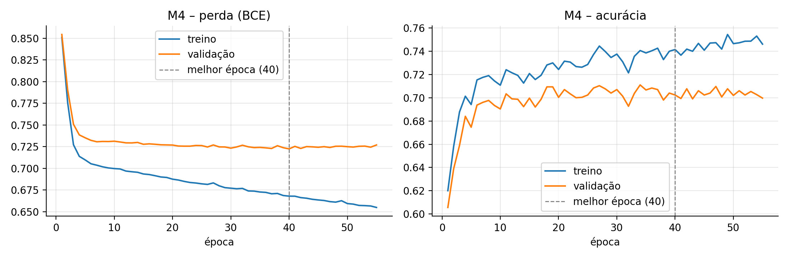
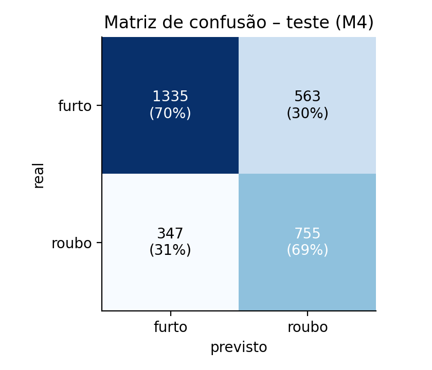

# Roubo ou furto? Classificação de ocorrências de celulares em São Paulo com MLP

Global Solution da disciplina **Aprendizado Profundo com Redes Neurais Convolucionais** (FIAP, Ciência da Computação).

Uma rede neural Multilayer Perceptron recebe as características de um boletim de ocorrência de celular subtraído
na cidade de São Paulo e estima se ele é mais compatível com **roubo** (art. 157 do Código Penal) ou com **furto**
(art. 155). Treinamos e comparamos seis arquiteturas em PyTorch com dados públicos da SSP-SP. O modelo escolhido é
usado por uma aplicação web em Streamlit.

> O modelo **não** prevê a chance de um crime acontecer em um local ou horário. Ele analisa uma ocorrência já
> registrada (ou hipotética) e indica com qual das duas naturezas ela se parece mais.

## Integrantes

| Nome | RM | E-mail |
|---|---|---|
| Gustavo Franzoti Gonçalves | RM566983 | RM566983@fiap.com.br |
| Maykon Santana Fonseca | RM567041 | RM567041@fiap.com.br |

## Entregas

| Entrega | Onde está |
|---|---|
| Código-fonte (preparação, MLP, aplicação) | `src/`, `app/`, `scripts/` |
| Notebook documentado | [`notebooks/mlp_roubo_furto_sp.ipynb`](notebooks/mlp_roubo_furto_sp.ipynb) |
| Relatório técnico (10 slides) | [`relatorio/relatorio_tecnico_mlp_roubo_furto.pdf`](relatorio/relatorio_tecnico_mlp_roubo_furto.pdf) e `.pptx` |
| Modelo treinado | `modelo/` |
| Aplicação web | <https://gs-mlp-roubo-furto-sp.streamlit.app/> (código em `app/app.py`) |

## Tecnologias

- Python 3.11+ (testado com 3.13)
- PyTorch: definição e treino das MLPs
- pandas e NumPy: preparação dos dados e inferência na aplicação
- Matplotlib: gráficos do notebook
- Jupyter: notebook do modelo
- Streamlit: aplicação web
- openpyxl e pyarrow: leitura da planilha da SSP
- pytest: testes

## Fonte dos dados e procedimento de obtenção

- **Órgão:** Secretaria da Segurança Pública do Estado de São Paulo (SSP-SP)
- **Página:** Portal de Estatísticas – Consultas, seção *Bases de Dados*, item *Celulares subtraídos*, período 2025:
  <https://www.ssp.sp.gov.br/estatistica/consultas>
- **Arquivo:** `CelularesSubtraidos_2025.xlsx` (108 MB, aba `CELULAR_2025`, 383.635 linhas e 55 colunas),
  baixado em 17/11/2026.

O arquivo bruto passa do limite de 100 MB do GitHub e por isso não está no repositório. O script
`scripts/baixar_dados.py` baixa o arquivo do link direto da SSP e executa a preparação:

1. recorte dos fatos ocorridos na capital (`NOME_MUNICIPIO_CIRC` e `CIDADE` = `S.PAULO`);
2. rótulo: `Roubo (art. 157)` = 1 e `Furto (art. 155)` = 0;
3. uma linha por boletim (última versão), descartando os 44 BOs que têm as duas rubricas;
4. montagem dos atributos e remoção de registros incompletos (157.327 BOs válidos);
5. amostra aleatória de 20.000 BOs (semente 42), salva em `data/processed/ocorrencias_sp_2025.csv`.

A amostra processada já está versionada, então o notebook e a aplicação funcionam sem baixar a base bruta.

### Atributos de entrada

`delegacia` (DP da área do fato), `periodo` (madrugada, manhã, tarde, noite), `dia_semana`, `tipo_local`,
`subtipo_local`, `marca` e `qtd_celulares`. Colunas que revelam a natureza do crime (`RUBRICA`, `CIRCUNSTANCIA`,
`DESDOBRAMENTO`, `DESCR_CONDUTA`), dados de registro (flagrante, bloqueio de IMEI) e endereço ficaram de fora. A
hora exata e as coordenadas também foram descartadas: o campo que vem preenchido depende do canal de registro e
vazaria o rótulo. O notebook traz a análise completa.

## Como executar

### 1. Clonar e criar o ambiente

```bash
git clone https://github.com/mykofonseca/gs-mlp-roubo-furto-sp.git
cd gs-mlp-roubo-furto-sp
python -m venv .venv
# Windows
.venv\Scripts\activate
# Linux/macOS
source .venv/bin/activate
pip install -r requirements.txt
```

### 2. Rodar a aplicação web

```bash
streamlit run app/app.py
```

A aplicação abre em <http://localhost:8501>. Ela usa os arquivos já treinados de `modelo/` e só depende de
`streamlit`, `numpy` e `pandas` (lista em `app/requirements.txt`).

### 3. Reproduzir o treinamento (opcional)

```bash
jupyter notebook notebooks/mlp_roubo_furto_sp.ipynb
```

Execute todas as células. O notebook lê `data/processed/ocorrencias_sp_2025.csv`, treina as seis MLPs, gera as
figuras em `docs/img/` e regrava os arquivos de `modelo/`. Para refazer também a preparação a partir da base bruta:

```bash
python scripts/baixar_dados.py
```

O download tem cerca de 108 MB, e a primeira leitura do xlsx leva alguns minutos. Depois disso o notebook passa a
mostrar também as células de exploração da base bruta.

### 4. Testes

```bash
python -m pytest -q tests
```

Os testes conferem a conversão de horário em período, a divisão estratificada, o tratamento de categorias
desconhecidas e se a inferência em NumPy dá o mesmo resultado que o PyTorch.

## Resultados

Métricas na validação (3.000 BOs, classe positiva = roubo):

| Modelo | Camadas ocultas | Ajuste | Acurácia | Precision | Recall | F1 |
|---|---|---|---|---|---|---|
| M1 | 16 | linha de base | 0,710 | 0,631 | 0,505 | 0,561 |
| M2 | 64-32 | mais capacidade | 0,716 | 0,648 | 0,494 | 0,560 |
| M3 | 64-32 | + peso de classe | 0,709 | 0,591 | 0,672 | 0,629 |
| **M4** | **64-32** | **+ Dropout 0,3, L2, lr 5e-4** | **0,702** | **0,577** | **0,711** | **0,637** |
| M5 | 128-64-32 | rede maior, Dropout 0,5 | 0,704 | 0,580 | 0,701 | 0,635 |
| M6 | 64-32 (tanh) | lr 1e-2 | 0,701 | 0,579 | 0,679 | 0,625 |

O **M4** foi escolhido pelo F1 na validação. No conjunto de teste (3.000 BOs, usado uma única vez) teve acurácia de
0,697, precision de 0,573, recall de 0,685 e F1 de 0,624.





## Aplicação web

**Acesse em: <https://gs-mlp-roubo-furto-sp.streamlit.app/>**

O formulário recebe os mesmos sete atributos usados no treino e mostra a classe estimada, as probabilidades de
roubo e de furto e a forma correta de interpretar o resultado.

| Ocorrência noturna em via pública | Ocorrência à tarde no metrô |
|---|---|
|  |  |

A aplicação está publicada no Streamlit Community Cloud a partir deste repositório (branch `main`, arquivo
principal `app/app.py`), com as dependências de `app/requirements.txt`.

## Estrutura de pastas

```
.
├── app/
│   ├── app.py                 # aplicação Streamlit
│   └── requirements.txt       # dependências mínimas para publicar a aplicação
├── data/
│   ├── raw/                   # base bruta da SSP (fora do Git; gerada pelo script)
│   └── processed/
│       ├── ocorrencias_sp_2025.csv   # amostra de 20.000 BOs usada no treino
│       └── resumo_preparacao.json    # contagens de cada etapa da preparação
├── docs/
│   ├── diagramas/             # fontes Mermaid dos diagramas
│   └── img/                   # gráficos, diagramas e prints da aplicação
├── modelo/
│   ├── mlp_roubo_furto.pt     # state_dict do PyTorch
│   ├── pesos_mlp.npz          # pesos usados pela aplicação
│   ├── preprocessador.json    # categorias, média e desvio do treino
│   ├── metadados.json         # arquitetura, métricas e opções do formulário
│   └── comparacao_arquiteturas.csv
├── notebooks/
│   └── mlp_roubo_furto_sp.ipynb
├── relatorio/                 # relatório técnico em PDF e PPTX
├── scripts/
│   └── baixar_dados.py        # download da SSP + preparação
├── src/
│   ├── config.py              # caminhos e constantes
│   ├── dados.py               # recorte, rótulo, deduplicação e atributos
│   ├── preprocessamento.py    # one-hot, z-score e divisão treino/validação/teste
│   ├── modelo.py              # MLP, laço de treino e métricas
│   └── inferencia.py          # propagação direta em NumPy para a aplicação
├── tests/
│   └── test_projeto.py
└── requirements.txt
```

## Limitações

A SSP avisa que a base é bruta e não constitui estatística oficial. O estudo cobre só celulares e só 2025, a
delegacia é uma aproximação grosseira do bairro e a descrição do local depende do relato da vítima. A violência ou
grave ameaça, que é o que distingue roubo de furto, só aparece em colunas que vazariam o rótulo. Por isso o
desempenho fica perto de 70% de acurácia.
